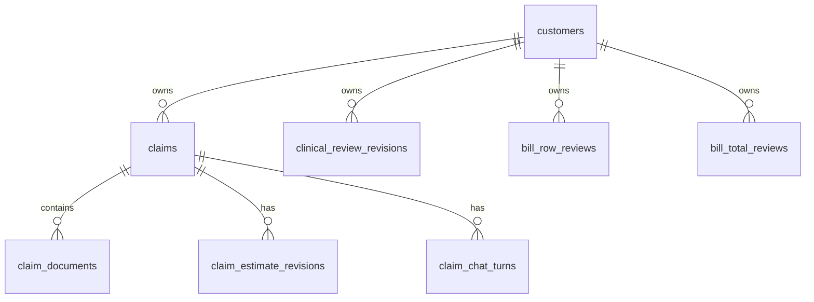

# Database design

Claims Assist uses PostgreSQL to store accounts, claims, document metadata, review history, estimates, and chat history. The schema is defined in [001_initial.sql](001_initial.sql). This guide describes the current design with fictional examples.

## Main relationships

A customer can create multiple claims. Each claim is intended for one patient and can contain a policy and several hospital PDFs. A customer can reuse a saved policy for a different claim.

## Tables and when they are populated

### customers

This table stores account identity and authentication information.

| Column | Purpose |
| --- | --- |
| `id` | Generated UUID identifying the customer. |
| `issuer`, `subject` | Identify the login provider and account. Local accounts use the normalized email as their subject. The pair must be unique. |
| `display_email` | Stores the account email for display. |
| `password_verifier` | Stores a random salt and an scrypt-derived password hash as bytes. |
| `created_at` | Records account creation time. |

When a customer signs up, the app generates a salt, hashes the password, and inserts an account row. At login, it uses the stored salt to verify the supplied password. See [customer_auth.py](../customer_auth.py).

### claims

Each row represents one claim workspace.

| Column | Purpose |
| --- | --- |
| `id` | Generated claim number. |
| `customer_id` | Owner of the claim, linked to `customers.id`. |
| `name` | Customer-provided claim name. |
| `sum_insured` | Optional positive sum insured. |
| `created_at` | Claim creation time. |

When a customer creates a claim named “Hospital visit,” the app inserts a row with that name and the signed-in customer's ID. The combination `(customer_id, id)` is also unique, allowing child tables to enforce the claim owner in their foreign keys.

### claim_documents

This table connects uploaded PDFs to a claim.

| Column | Purpose |
| --- | --- |
| `customer_id`, `claim_id` | Identify the owner and claim. Their combined foreign key must match an existing claim. |
| `position` | Position `0` identifies the policy. Positive positions identify hospital PDFs in upload order. |
| `filename` | Original filename displayed in the app. |
| `storage_key` | Generated relative filename for a PDF saved on disk. |
| `content_sha256` | SHA-256 checksum used to detect changed file contents when reading. |
| `pdf` | Stores embedded bytes for older records. New file-backed records use an empty byte value. |

The primary key is `(claim_id, position)`. For example, uploading a policy and bill creates positions `0` and `1`. New PDFs live under `.claims-data/documents` by default. Selecting an already saved policy can reuse its file key in another claim. See [claim_store.py](../claim_store.py).

### clinical_review_revisions

This table records versions of clinical and related review values. It contains `customer_id`, `document_hash`, the `field` name, `previous_value`, `reviewed_value`, `extracted_value`, an optional `source_page`, and `saved_at`.

For example, if the app extracts “Gallstones” and the customer corrects the diagnosis, it records the extracted and reviewed values. A later correction creates another revision. The app also uses this table for fields such as ICD-10 mappings, bill acceptance, manually entered waiting periods, saved AI suggestions, and policy start dates. Some of these use a derived key tied to the claim and policy. See [clinical_review_store.py](../clinical_review_store.py).

### bill_row_reviews

This table stores revisions of itemized bill charges. Each row contains the customer, a document or bill-section hash, original and reviewed values as serialized text, and the save time.

When a customer edits the quantity, rate, or amount of a bill item and the edit saves, a revision is added. The original values remain available in the revision record. See [bill_review.py](../bill_review.py).

### bill_total_reviews

This table uses the same structure as `bill_row_reviews` for bill totals. Its `original` and `reviewed` fields contain serialized total values.

For example, correcting an extracted net bill from ₹20,000 to ₹22,000 creates a total-review revision. See [bill_total_review.py](../bill_total_review.py).

### claim_estimate_revisions

Each row stores a saved estimate revision. It contains the customer and claim IDs, a `bill_hash`, a `policy_hash`, a serialized `snapshot`, and `saved_at`.

When the customer calculates an estimate, the snapshot records the inputs and calculation result, including applicable deductions and co-payment. Saving a changed estimate can create a later revision. The composite foreign key ties the estimate to a claim owned by that customer. See [estimate_store.py](../estimate_store.py).

### claim_chat_turns

Each row stores a chat question and its answer for a claim. The table contains the customer and claim IDs, the `question`, an `answer` stored as JSONB, and `created_at`. The answer can include text and source references.

When the customer sends a question, the app saves the response as a new turn. An index on `(customer_id, claim_id, id)` supports loading the claim's chat history.

## Customer isolation

The application uses the restricted `claims_app` PostgreSQL role. For an authenticated request, it sets `app.customer_id` for the database transaction. Row-level security policies on the seven claim-data tables use that value to restrict reads and inserts to that customer's rows. Composite foreign keys also connect documents, estimates, and chat turns to claims with matching owners. See [postgres_storage.py](../postgres_storage.py).

The `customers` table supports account lookup during login and is handled separately from those claim-data policies. Passwords are hashed with a unique random salt. The database administrator and the application's database role are different accounts.

## Where the PDFs and vectors are stored

PostgreSQL stores document metadata and, for older records, may contain the PDF bytes. New PDFs are written to the configured local document folder. The app checks the checksum when loading a file. Back up the database and PDF folder together.

Policy embeddings and searchable passages are stored in local Chroma storage under `.claims-data/policy_vectors` by default. They are separate from the PostgreSQL tables. The index includes the customer ID in its identity so customers' policy indexes are scoped separately. See [policy_vectors.py](../policy_vectors.py).

## Example end-to-end flow

1. A customer signs up. A `customers` row is created.
2. They create a claim and upload a policy, bill, and discharge summary. The app inserts a `claims` row and three `claim_documents` rows.
3. They correct the diagnosis and bill total. The app adds clinical and total-review revisions.
4. They check a waiting period and save the policy start date. The date is stored as a clinical review value using a claim-and-policy-derived key.
5. They calculate an estimate. The app stores a snapshot in `claim_estimate_revisions`.
6. They ask a question. The app stores the question and answer in `claim_chat_turns`. Policy embeddings are stored in Chroma when the index is built.
